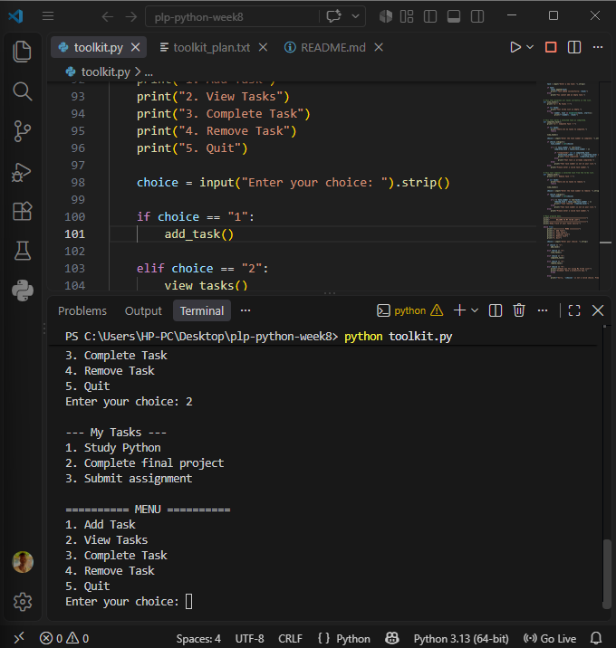
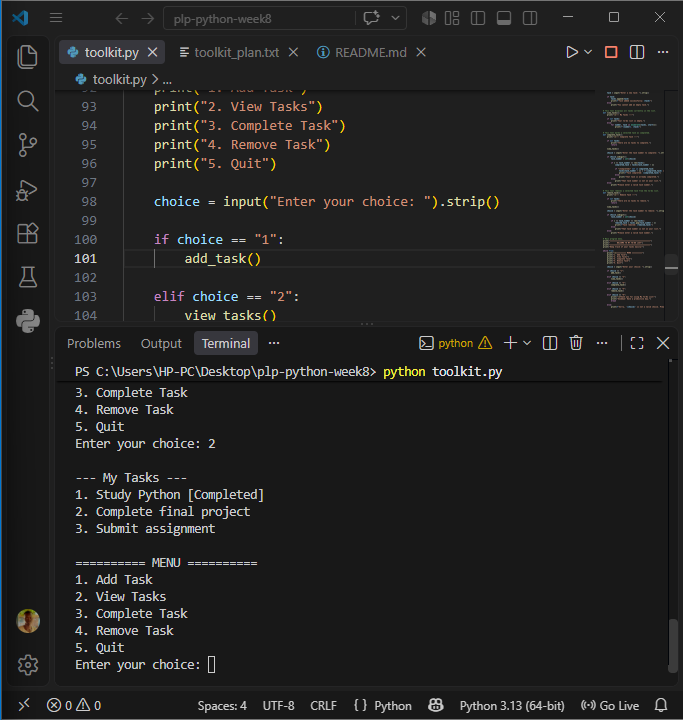
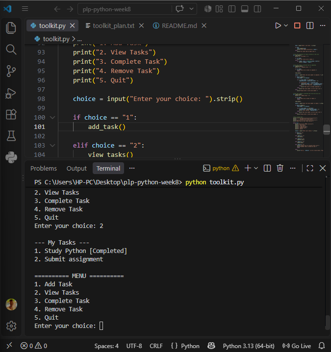
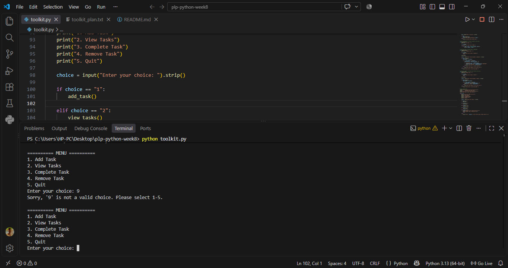

# Personal Mini-Toolkit – To-Do List Manager


## Project Overview

The **Personal Mini-Toolkit – To-Do List Manager** is a command-line application developed in Python as part of the Power Learn Project (PLP) Python Week 8 assignment.

The application helps users organize daily activities by creating, viewing, completing, and removing tasks through a simple interactive menu.

The project demonstrates fundamental Python programming concepts, input validation, error handling, automated testing, and version control.

## Features

- **Add Tasks:** Create new tasks and add them to your to-do list.
- **View Tasks:** Display all available tasks and their completion status.
- **Complete Tasks:** Mark tasks as completed.
- **Remove Tasks:** Delete tasks that are no longer needed.
- **Input Validation:** Prevent empty tasks and invalid task numbers.
- **Error Handling:** Handle incorrect menu selections and non-numeric inputs.
- **Duplicate Completion Protection:** Prevent tasks from being marked as completed more than once.

## Technologies Used

- Python 3
- Git and GitHub
- Python `unittest` framework
- GitHub Actions for automated testing

## Project Structure

```text
plp-python-week8/
│
├── .github/
│   └── workflows/
│       └── python-tests.yml
│
├── screenshots/
│   ├── menu_invalid_choice.png
│   ├── task_adding.png
│   ├── task_completed.png
│   └── task_removed.png
│
├── tests/
│   └── test_toolkit.py
│
├── .gitignore
├── README.md
├── toolkit.py
└── toolkit_plan.txt
```

## Getting Started

### 1. Clone the repository

```bash
git clone https://github.com/Nhialmabior/plp-python-week8.git
```

### 2. Navigate into the project directory

```bash
cd plp-python-week8
```

### 3. Run the application

```bash
python toolkit.py
```

### 4. Run automated tests

```bash
python -m unittest discover -s tests -v
```

## Application Menu

```text
========== MENU ==========
1. Add Task
2. View Tasks
3. Complete Task
4. Remove Task
5. Quit
Enter your choice:
```

## Screenshots

The following screenshots demonstrate the main application features.

### Task Management

**Adding a task**



**Completing a task**



**Removing a task**



### Input Validation

**Handling an invalid menu selection**



## Testing and Quality Assurance

The project includes automated unit tests using Python's built-in `unittest` framework.

**Latest test results: 8 tests passed, 0 failures.**

The tests cover:

1. Adding tasks.
2. Completing tasks.
3. Rejecting empty tasks.
4. Handling invalid task numbers.
5. Handling non-numeric task numbers.
6. Removing tasks.
7. Preventing duplicate task completion.
8. Displaying an empty task list.

### Continuous Integration

GitHub Actions automatically runs the test suite when changes are pushed to the repository.

The workflow helps ensure that updates do not introduce unexpected errors.

## Learning Outcomes

Through this project, I strengthened my understanding of:

- Variables and Python data structures.
- Lists and list manipulation.
- Functions and modular programming.
- Conditional statements.
- Loops and user interaction.
- Input validation and exception handling.
- Automated unit testing.
- Git and GitHub version control.
- Continuous Integration using GitHub Actions.

## Future Improvements

Potential future enhancements include:

- Saving tasks permanently using file handling or a database.
- Adding task priorities and deadlines.
- Introducing task categories.
- Developing a graphical user interface.
- Building a web-based version of the application.

## Author

**Nhial Mabior Garang**

Python Developer | Frontend Developer | Data Analyst

- GitHub: https://github.com/Nhialmabior
- LinkedIn: https://www.linkedin.com/in/nhial-mabior/

*Developed as part of the Power Learn Project Africa – Python Programming, Week 8.*
